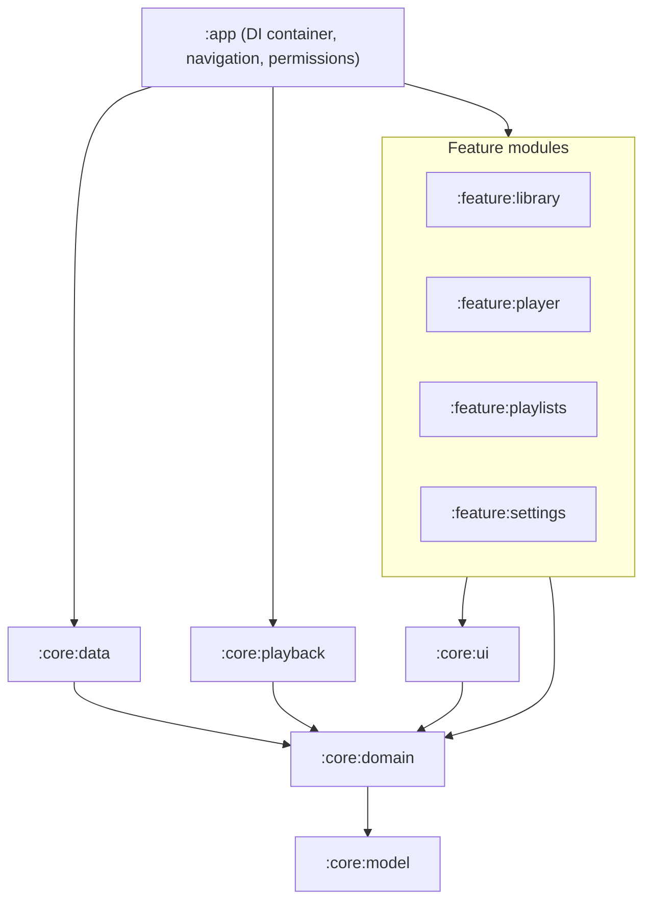
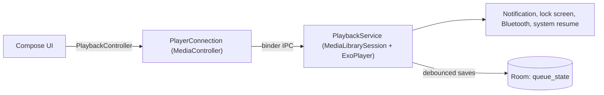

# BarePlayer

An offline, ad-free local music player for Android. No internet permission, no ads, no analytics,
no tracking. Kotlin, Jetpack Compose (Material 3), AndroidX Media3, Room.

- Library: Songs, Albums, Artists, Genres and Folders views, fast full-text search
- Now Playing, mini-player, shuffle and repeat, queue with drag-to-reorder and swipe-to-remove
- Background playback with media notification, lock screen, Bluetooth/headset controls,
  audio focus handling and pause on headphone unplug
- Playlists: create, rename, delete, add/remove/reorder tracks
- The queue and position are restored after restart, including from system media controls
- Light, dark and system themes, with dynamic color on Android 12+

minSdk 26 (Android 8.0), targetSdk/compileSdk 37.

## Build and run

Requirements: JDK 17+ (JDK 21 recommended) and the Android SDK with platform 37. Point
`ANDROID_HOME` at the SDK, or create `local.properties` with `sdk.dir=...`.

```bash
./gradlew assembleDebug                                   # debug APK
./gradlew assembleDebug lint test verifyNoInternetPermission  # quality gate used for every milestone
adb install app/build/outputs/apk/debug/app-debug.apk
```

`verifyNoInternetPermission` (also part of `check`) fails the build if the merged manifest of any
variant requests `INTERNET`, `ACCESS_NETWORK_STATE`, `ACCESS_WIFI_STATE` or
`CHANGE_NETWORK_STATE`. The requested permissions are written to
`app/build/reports/network-permissions/<variant>.txt`.

### Release builds

`./gradlew assembleRelease` (or `bundleRelease` for Play) runs R8 with resource shrinking. Signing
reads `keystore.properties` in the project root (git-ignored):

```properties
storeFile=release.jks
storePassword=...
keyAlias=...
keyPassword=...
```

Without that file, release builds are signed with the debug key so the minified build can be
installed and smoke-tested locally. Never upload a debug-signed build.

### Baseline Profile and benchmarks

These need a connected device or emulator (API 33+ for non-rooted profile generation) with some
music on it:

```bash
./gradlew :app:generateReleaseBaselineProfile                 # writes app/src/release/generated/baselineProfiles/
./gradlew :baselineprofile:connectedBenchmarkReleaseAndroidTest  # cold start + scroll jank, physical device
```

Commit the generated profile. `profileinstaller` applies it on devices that install outside of
Play; Play applies it through cloud profiles.

### Troubleshooting: TLS-inspecting networks

If Gradle fails with `PKIX path building failed`, your network re-signs HTTPS with a root
certificate that Java doesn't trust. On Windows, add this to `~/.gradle/gradle.properties` (not the
project file) to use the Windows certificate store. The build forwards it to test JVMs too, which
Robolectric needs to download Android jars:

```properties
systemProp.javax.net.ssl.trustStoreType=Windows-ROOT
```

## Architecture



| Module | Type | Responsibility |
| --- | --- | --- |
| `:core:model` | Kotlin/JVM | Immutable models (`Track`, `Album`, `QueueSnapshot`, ...) |
| `:core:domain` | Kotlin/JVM | Repository interfaces, `PlaybackController` contract, pure logic: `QueueMath`, `QueueRestorer`, `LibraryDiff`, `SearchQuery`, `SortKeys`, playlist use cases |
| `:core:data` | Android library | `MediaStoreScanner`, `LibrarySync`, Room database with FTS4, DataStore preferences |
| `:core:playback` | Android library | `PlaybackService` (Media3 `MediaLibraryService` + ExoPlayer), `PlayerConnection` (`MediaController` bridge) |
| `:core:ui` | Android library | Material 3 theme, bundled vector icons, shared components, Coil artwork fetcher |
| `:feature:*` | Android library | Compose screens and ViewModels (MVVM, one `StateFlow` per concern) |
| `:app` | Application | `AppContainer` (manual DI), navigation host, permission gate |
| `:baselineprofile` | Test | Baseline Profile generator and macrobenchmarks |
| `build-logic` | Included build | Convention plugins and the network-permission check |

Feature modules depend only on `:core:domain` interfaces, so the domain and data logic stays
portable: `:core:model` and `:core:domain` contain no Android types and can become Kotlin
Multiplatform `commonMain` for an iOS version. Room, DataStore and Coil 3 already support KMP.

### Library data flow

1. `AudioPermissionGate` requests `READ_MEDIA_AUDIO` (API 33+) or `READ_EXTERNAL_STORAGE` (API 26-32).
2. `LibrarySync` queries `MediaStore.Audio.Media` with a minimal projection, diffs the result
   against fingerprints in Room (`LibraryDiff`), and writes only changed rows in one transaction.
   On API 30+, the scan is skipped at startup when MediaStore's version and generation haven't
   changed. A `ContentObserver` triggers a debounced rescan when files change.
3. Albums, artists, genres and folders are aggregated with indexed SQL `GROUP BY` queries, so
   they can never drift from the track table. Search uses an FTS4 table (unicode61 tokenizer,
   accent-insensitive prefix matching) kept in sync by Room triggers.
4. Repositories expose `Flow`s; ViewModels convert them to `StateFlow`s; Compose renders them
   with stable keys and content types. A 10,000-track test asserts the song list is served by an
   index without a sort step.

### Playback



- ExoPlayer handles audio focus (pausing for calls), becoming-noisy (headphone unplug) and a
  local wake lock. Media3 manages the `mediaPlayback` foreground service and the notification.
- Shuffle uses ExoPlayer's shuffle order. Enabling shuffle keeps the current song playing first;
  "Play next" in shuffle mode really plays next, through a custom `SET_SHUFFLE_ORDER` session
  command that only BarePlayer's own controller may send.
- The queue (track ids, index, position, shuffle order, repeat mode) is saved on every change
  (debounced), every 10 s while playing, and when the service stops. It is restored paused when
  the service starts, and through `onPlaybackResumption` for system media controls and Bluetooth.
- Tracks the device can't decode (for example FLAC on Android 8.0, which has no platform FLAC
  decoder) are skipped with a message instead of playing silence.

### Artwork

`ArtFetcher` (a Coil 3 fetcher, no network module) resolves art without extra permissions. On API
29+ it uses `ContentResolver.loadThumbnail`, which the system builds from embedded art and falls back to
`cover`/`folder`/`albumart` images in the track's folder. On API 26-28 it tries MediaStore album
art, then embedded art, then `cover.jpg`/`folder.jpg` next to the file. Art is cached in memory by
album and requested at thumbnail size.

### Dependencies

| Dependency | Why |
| --- | --- |
| Compose BOM, Material 3, activity/lifecycle/navigation-compose | UI toolkit and type-safe navigation |
| core-splashscreen | Consistent splash on API 26-31; held until the theme preference loads |
| media3-exoplayer, media3-session | Playback, notification, lock screen, Bluetooth, resumption |
| kotlinx-coroutines-guava | Bridges Media3's `ListenableFuture` APIs to coroutines |
| Room + KSP | Library index, FTS search, playlists, queue, play counts |
| DataStore | Theme and scan-token preferences |
| Coil 3 (compose only) | Downsampled, memory-cached artwork for smooth scrolling |
| profileinstaller | Applies the Baseline Profile for fast cold start |
| kotlinx-serialization-core | Type-safe navigation routes |
| Test: JUnit, coroutines-test, Turbine, Robolectric | JVM tests, including Room and cursor mapping |

Deliberately not used: Hilt (manual DI is smaller, KMP-friendly), Paging (10k rows load fine),
material-icons-extended (icons are bundled vectors), any network, analytics, or crash SDK.

## Known limitations

- **FLAC on Android 8.0 (API 26):** no platform decoder; such tracks are skipped with a message.
  Android 8.1+ plays FLAC. (All prebuilt FFmpeg decoders for Media3 are GPL-3.0, which would force
  the app to be GPL-3.0, so none is bundled.)
- **Android Auto:** the service is a `MediaLibraryService` with an empty browse tree. Auto support
  needs browsing plus the `com.google.android.gms.car.application` metadata, which triggers Play's
  Auto review, so it is deliberately not declared yet.
- **Baseline Profile:** the generator is in place; the profile itself must be generated on a device.

## Play Store compliance checklist

- [x] No `INTERNET` or network-state permission in any variant (enforced by `verifyNoInternetPermission`)
- [x] `READ_MEDIA_AUDIO` on 33+, `READ_EXTERNAL_STORAGE` capped with `maxSdkVersion="32"`; no `MANAGE_EXTERNAL_STORAGE`, no photo/video permissions
- [x] Foreground service typed `mediaPlayback` with `FOREGROUND_SERVICE_MEDIA_PLAYBACK`
- [x] `POST_NOTIFICATIONS` requested once, optional (media notifications are exempt)
- [x] targetSdk 37, edge-to-edge, predictive back (`enableOnBackInvokedCallback`)
- [x] Native libraries (AndroidX only) are 16 KB page-size aligned
- [x] Backup rules exclude the rebuildable library database
- [ ] Play Console: declare the `mediaPlayback` foreground service use (video of background playback)
- [ ] Play Console Data safety: "No data collected", "No data shared"
- [ ] Privacy policy URL: host `docs/privacy-policy.html` (e.g. GitHub Pages from the `docs/` folder) after replacing `CONTACT_EMAIL`
- [ ] Store listing: text in `store/listing.md`, screenshots in `store/screenshots/`, feature graphic `store/feature_graphic_1024x500.png`, icon `design/icon/play_store_icon_512.png`
- [ ] Upload key and Play App Signing; `keystore.properties` for local release builds
- [ ] Generate and commit the Baseline Profile; upload an AAB (`./gradlew bundleRelease`)

## Manual test checklist (real device)

1. Fresh install: the permission screen appears; deny once, then grant. The library populates.
2. Songs list with a large library: fling hard and drag the fast-scroll thumb. Watch for jank.
3. Albums, Artists, Genres, Folders: open details, play, shuffle; art loads (embedded and `cover.jpg`).
4. Search for an accent-insensitive prefix, e.g. "beyo" finds "Beyoncé".
5. Play an album, lock the screen, use the lock-screen and notification controls.
6. Bluetooth headset or wired headphones: play/pause/next buttons; unplug pauses playback.
7. Phone call or another media app: BarePlayer pauses and resumes appropriately.
8. Queue: drag to reorder, swipe to remove, tap to jump; with shuffle on, "Play next" plays next.
9. Swipe the app away while paused, relaunch: the queue and position are restored.
10. Reboot, then press play on a Bluetooth device or use the system media resume control.
11. Playlists: create, add from any list and from Now Playing, reorder, remove, rename, delete.
12. Settings: switch Light/Dark/System and dynamic color; rescan the library.
13. Android 8.0 device or emulator with a FLAC file: the track is skipped with a message.
14. Delete a song file while it's queued: playback skips it with a message.
